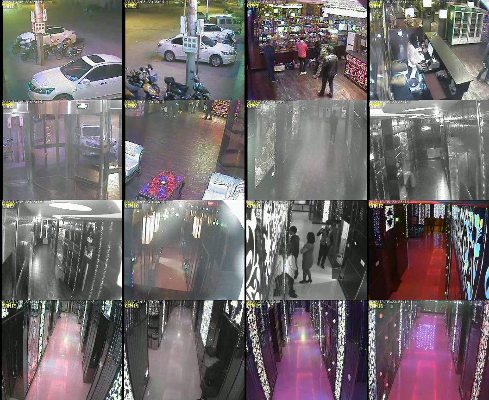

# multicam-dump-player

Open recorder dumps that put **many cameras in one file**, and play them as a grid, with every camera on the same clock.



*The bundled sample: 16 cameras, 8 seconds, all cells at the same on-screen time (22:25:14).*

## The problem

Some DVRs export a recording as a single `.dat` file that holds 16 cameras. Ordinary players open it, if at all, as one camera or as noise.
FFmpeg can already read the container (its `luodat` demuxer); what is missing is something that **shows all the cameras together on a common time line**.

That last part is less obvious than it looks. In the sample the cameras' own timestamps start up to **11 seconds apart**, yet the cameras were
recording at the same moment (the clocks painted in each picture agree). Laying the grid out by timestamp leaves most cells dark for the first seconds.
`multicam-dump-player` aligns the cameras by the **order in which their records were written** instead — see [docs/ALIGNMENT.md](docs/ALIGNMENT.md).

## Install

```bash
git clone https://github.com/tracewind-world/multicam-dump-player && cd multicam-dump-player
pip install .                            # installs the `mcdump` command; or run `python -m multicam_dump` straight from the folder
pip install opencv-python                # only if you want the player window (`play`); the default install uses opencv-python-headless
```

Tested with Python 3.12, PyAV 17.1 (FFmpeg 8) and OpenCV 5 on Windows.

## Use

```bash
python -m multicam_dump info   samples/file0000.dat              # cameras, frames, key frames, offsets
python -m multicam_dump export samples/file0000.dat -o grid.mp4  # the grid as an MP4 (about real time)
python -m multicam_dump split  samples/file0000.dat -d channels  # each camera as a raw .h264 file
python -m multicam_dump play   samples/file0000.dat              # window: space = pause, n = step, q = quit
```

Each camera in `channels/` is a raw H.264 stream at 16 fps: `ffmpeg -f h264 -framerate 16 -i ch01.h264 -c copy ch01.mp4`.

`info` on the sample:

```
file0000.dat: 16 cameras, 2107 records, 352x288 @ 16 fps, grid 4x4
common timeline 0.00 s .. 8.38 s  (8.4 s); reference camera CH01
  CH01  id 1493672012   134 frames    5 key  container pts 1310209..1310342  offset  +0.00 s
  CH14  id 1144854014   131 frames    4 key  container pts 1310180..1310310  offset  +0.11 s
  ...
```

## Limits

- One container family: the "luo" recorder `.dat` ([format notes](docs/FORMAT.md)). Other multi-camera dumps use other layouts.
- Video only. The sample has no audio records.
- Cameras whose first key frame is not at the start of the dump stay black until their first key frame arrives; the packets before it are counted and reported, never hidden.
- Alignment is exact to about one write burst (under a second); it is an estimate from the record order, not a recorded timecode.
- The sample is a piece cut out of a longer recording, so it ends in the middle of the data.

## Tests

```bash
python -m unittest discover -s tests -v
```

## About

Built by [Tracewind](https://tracewind.world/) while working on recordings that other players cannot open.
More on proprietary DVR/NVR exports and what to do with them: <https://tracewind.world/formats/>.
For many other formats in one player (with a free 30-day trial): [Tracewind Player](https://tracewind.world/download/player/).

Issues and pull requests that add another multi-camera dump layout are welcome — please attach a small sample you have the right to share.

## License

Apache License 2.0 (see [LICENSE](LICENSE)). The name and logo of Tracewind are not covered by the licence.
The sample file is an old recording provided by its owner for use as a test sample ([samples/README.md](samples/README.md)).
